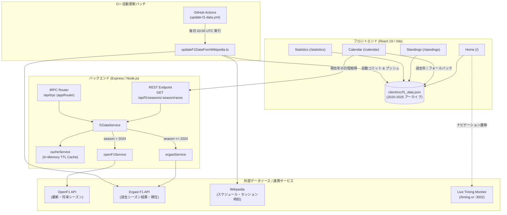
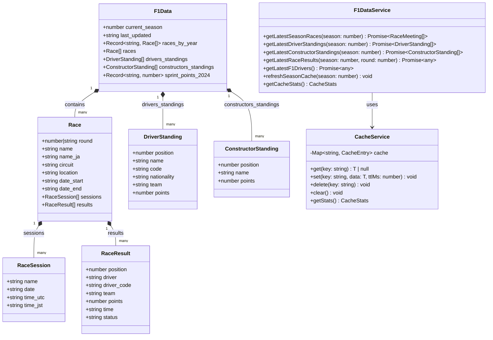
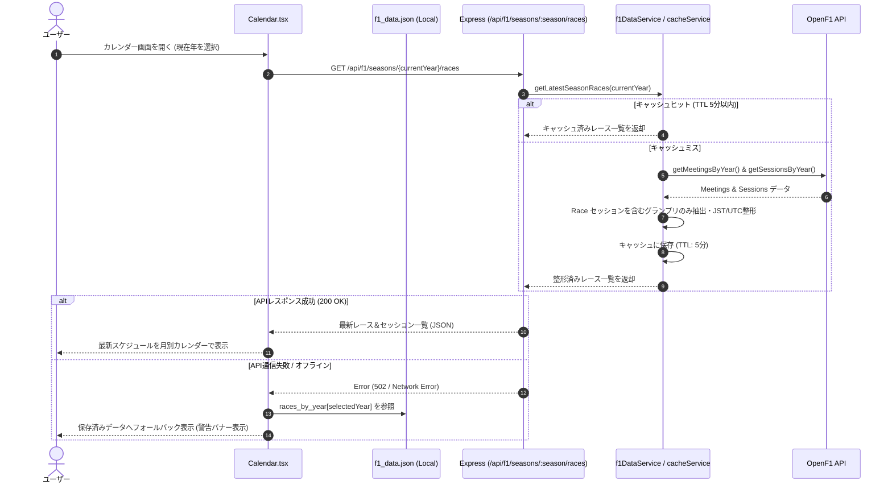
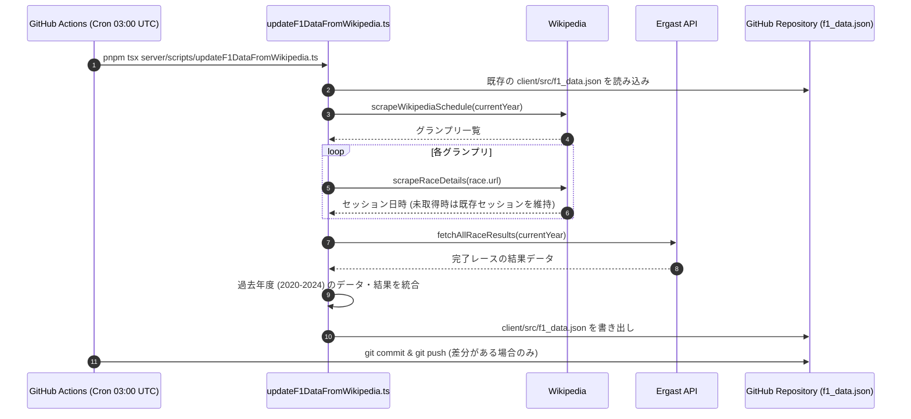

# F1 Calendar & Timing App

## 公開URL

[F1-Calendar を開く](https://f1-calendar-chi.vercel.app/)

## リポジトリ概要

**F1 Calendar & Timing App** は、F1（フォーミュラ1）のレース日程・セッションスケジュール（日本時間/UTC対応）、ドライバーズ＆コンストラクターズのポイントランキング、およびシーズン統計データを直感的に確認できるWebアプリケーションです。

最新シーズンのスケジュールは **OpenF1 API**（バックエンドキャッシュ付きRESTエンドポイント経由）から動的に取得しつつ、**GitHub Actions** によって毎日自動更新される **Wikipedia / Ergast API** ベースのアーカイブデータ（2020年〜2025年）をフォールバックおよび過去シーズン閲覧用として内蔵しています。また、ライブタイミングモニター（`/timing`）へのシームレスなナビゲーション連携や、Docker / Vercel を用いた柔軟なデプロイに対応しています。

---

## 主な機能

### 1. レースカレンダー (`/calendar`)
- 📅 **年度別・月別カレンダー表示**: 最新シーズンおよび過去シーズン（2020年〜2025年）を年度・月ごとに切り替え可能
- 🏁 **日本時間（JST）対応のセッション詳細**: フリー走行（FP1〜FP3）、スプリント予選、スプリント、予選、決勝の日時をJSTとUTCで並記
- 🌍 **サーキット・開催地情報**: 各グランプリのサーキット名と開催都市・国名を表示
- 🏆 **レース＆スプリント結果**: 完了したレースおよびスプリントの順位・ドライバー・チーム・獲得ポイント・タイムを表示
- 🔄 **ハイブリッドデータ取得**: 現在年は `/api/f1/seasons/:season/races` 経由でOpenF1の最新スケジュールを取得し、オフライン時やAPI障害時はローカルの保存済みデータへ自動フォールバック

### 2. スタンディングス（順位表） (`/standings`)
- 🏆 **ドライバーズチャンピオンシップ**: 順位、ドライバー名、所属チーム、獲得ポイントの一覧
- 🏎️ **コンストラクターズチャンピオンシップ**: チームカラーアイコン付きのコンストラクター順位表
- 📊 **優勝確定までの必要ポイント計算**: 最大獲得可能ポイントから逆算した必要ポイント差を表示
- 🗂️ **過去シーズン集計**: 2020年以降の過去シーズンもレース結果（スプリント含む）から順位表を自動算出

### 3. 統計・データ分析 (`/statistics`)
- 📈 **ポイント推移グラフ（LineChart）**: トップ10ドライバーのラウンドごとの累積ポイント推移を可視化
- 📊 **ポイント比較チャート（BarChart）**: トップ10ドライバーおよびコンストラクターの獲得ポイント比較
- 🥧 **ポイント分布（PieChart）**: トップ3、トップ4〜10、その他グループの獲得ポイント割合を分析
- 📋 **シーズンサマリー**: 現在のリーダー（過去年度はチャンピオン）、総レース数、総ドライバー数を一覧表示

### 4. ホーム＆ライブタイミング連携 (`/`)
- ⏱️ **NEXT RACE ハイライト**: 次回開催されるグランプリの基本情報と全セッションの日本時間スケジュールをトップページに表示
- 📻 **ライブタイミング連携**: 統合デプロイ環境のライブタイミングモニター（本番: `/timing`、ローカル開発: `http://localhost:3002` または `VITE_TIMING_URL`）へのナビゲーションリンクを搭載

---

## アーキテクチャ & UML図

フロントエンド（React 19 + Vite）とバックエンド（Express + tRPC / REST API）を統合した構成になっており、Dockerコンテナ等のフルスタック実行環境と、Vercel等の静的ホスティング環境の両方で動作します。

### 1. システム構成図（コンポーネント図）



### 2. クラス図（データモデル & サービス構造）



### 3. シーケンス図（カレンダー表示 & データ自動更新フロー）

#### カレンダー画面のスケジュール取得シーケンス


#### GitHub Actions による日次データ自動更新シーケンス


---

## 技術スタック

### フロントエンド
- **React 19** / **TypeScript** - UI構築・型安全な開発
- **Vite 7** - 高速開発サーバー＆バンドラー
- **Tailwind CSS 4** / **Radix UI** / **Lucide React** - スタイリング＆アクセシブルなUIコンポーネント
- **Recharts** - 統計グラフ・チャート描画
- **Wouter** - 軽量ルーティング
- **TanStack Query** / **tRPC Client** - データフェッチング・状態管理

### バックエンド
- **Node.js** / **Express** - アプリケーション＆APIサーバー
- **tRPC Server** - 型安全なAPIルーター（`/api/trpc`）
- **REST API** - カレンダー用キャッシュ付き公開エンドポイント（`/api/f1/seasons/:season/races`）
- **Drizzle ORM** / **MySQL2** - データベーススキーマ・永続化基盤

### 外部データソース
- **OpenF1 API** - 現在・将来のF1カレンダーおよびセッション・ドライバー情報
- **Ergast F1 API** - 過去のF1レース結果・ランキングデータ
- **Wikipedia** - セッション詳細スケジュールおよびグランプリ情報の補完

---

## セットアップと実行方法

### 必要要件
- **Node.js**: v20以上推奨
- **パッケージマネージャー**: `pnpm` (v10)

### 1. リポジトリのクローンと依存関係インストール

```bash
git clone https://github.com/sofardogood/F1-Calendar.git
cd F1-Calendar
pnpm install
```

### 2. 環境変数の設定（任意）

必要に応じて `.env` ファイルを作成します（未設定でも基本機能はそのまま動作します）：

```bash
# サーバーポート（デフォルト: 3000、使用中の場合は空きポートを自動探索）
PORT=3000

# ライブタイミングモニターのURL（オプション）
# 未設定時は開発環境で http://localhost:3002、本番環境で /timing を使用
VITE_TIMING_URL=http://localhost:3002

# データベース・認証連携を使用する場合（オプション）
DATABASE_URL=your_database_url
JWT_SECRET=your_jwt_secret
```

### 3. 開発サーバーの起動

```bash
pnpm dev
```

`http://localhost:3000` で開発サーバーが起動します。

### 4. 本番ビルドと起動

```bash
pnpm build
pnpm start
```

### 5. Docker でのビルド・起動

マルチステージビルド対応の `Dockerfile` が用意されています。

```bash
docker build -t f1-calendar .
docker run -p 3000:3000 f1-calendar
```

---

## 利用可能なスクリプト

### アプリケーション操作

```bash
pnpm dev          # 開発サーバー起動 (tsx watch)
pnpm build        # フロントエンド (Vite) & サーバー (esbuild) の本番ビルド
pnpm start        # 本番サーバー起動 (node dist/index.js)
pnpm check        # TypeScript 型チェック (tsc --noEmit)
pnpm format       # Prettier によるコードフォーマット
pnpm test         # Vitest によるテスト実行
pnpm db:push      # Drizzle データベースマイグレーション生成・適用
```

### データ更新・CSV管理スクリプト

```bash
# Wikipedia と Ergast API からデータを取得して client/src/f1_data.json を更新
pnpm tsx server/scripts/updateF1DataFromWikipedia.ts

# F1Pro日本語サイトからスケジュールを更新
pnpm tsx server/scripts/updateF1Data.ts

# 指定年度のデータをCSV（races / sessions / results）にエクスポート
pnpm tsx server/scripts/exportYearToCSV.ts 2025

# 指定年度のCSVデータを client/src/f1_data.json の races_by_year にインポート
pnpm tsx server/scripts/parseYearlyCSV.ts 2025
```

#### 年度別CSVファイル形式
各年度のアーカイブデータは以下のCSVファイル群で管理できます：
- `F1-<YEAR>-races.csv`: レース基本情報（ラウンド、英語名、日本語名、サーキット、開催地、開始日、終了日）
- `F1-<YEAR>-sessions.csv`: セッション情報（ラウンド、セッション名、日付、UTC時刻、JST時刻）
- `F1-<YEAR>-results.csv`: レース結果（ラウンド、順位、ドライバーコード、ドライバー名、チーム、ポイント、グリッド、周回数、タイム、ステータス）
- `F1-<YEAR>-sprint-results.csv` / `F1-<YEAR>-sprint-points.csv`: スプリント結果・ポイント情報

---

## プロジェクト構造

```
F1-Calendar/
├── .github/workflows/
│   └── update-f1-data.yml     # 毎日自動実行されるデータ更新ワークフロー
├── client/                    # フロントエンド
│   ├── index.html             # エントリーHTML（日本語ロケール）
│   └── src/
│       ├── pages/             # 各画面（Home, Calendar, Standings, Statistics, History 等）
│       ├── components/        # UIコンポーネント（Radix UI / shadcn/ui ベース）
│       ├── contexts/          # テーマ管理コンテキスト
│       ├── hooks/             # カスタムフック
│       ├── lib/               # ユーティリティ・tRPCクライアントシム
│       └── f1_data.json       # F1スケジュール・ランキング・過去年度アーカイブデータ
├── server/                    # バックエンド
│   ├── _core/                 # Express / Vite統合・OAuth・tRPC基盤・RESTエンドポイント
│   ├── services/              # 外部データ取得・キャッシュサービス
│   │   ├── f1DataService.ts       # OpenF1 / Ergast 統合サービス（キャッシュ付き）
│   │   ├── openF1Service.ts       # OpenF1 API クライアント
│   │   ├── ergastService.ts       # Ergast API クライアント
│   │   ├── wikipediaScraper.ts    # Wikipedia スクレイパー
│   │   ├── f1Scraper.ts           # F1スケジュールスクレイパー
│   │   └── cacheService.ts        # インメモリキャッシュ管理
│   ├── scripts/               # データ更新・CSVインポート/エクスポート用スクリプト群
│   └── routers.ts             # tRPC ルーター定義
├── shared/                    # フロントエンド・バックエンド共有型定義・定数
├── drizzle/                   # Drizzle ORM スキーマ・マイグレーション
├── patches/                   # パッケージパッチ（wouter等）
├── Dockerfile                 # Docker マルチステージビルド定義
├── pnpm-workspace.yaml        # pnpm ワークスペース・ビルド設定
└── vercel.json                # Vercel デプロイ設定
```

---

## ライセンス

MIT
